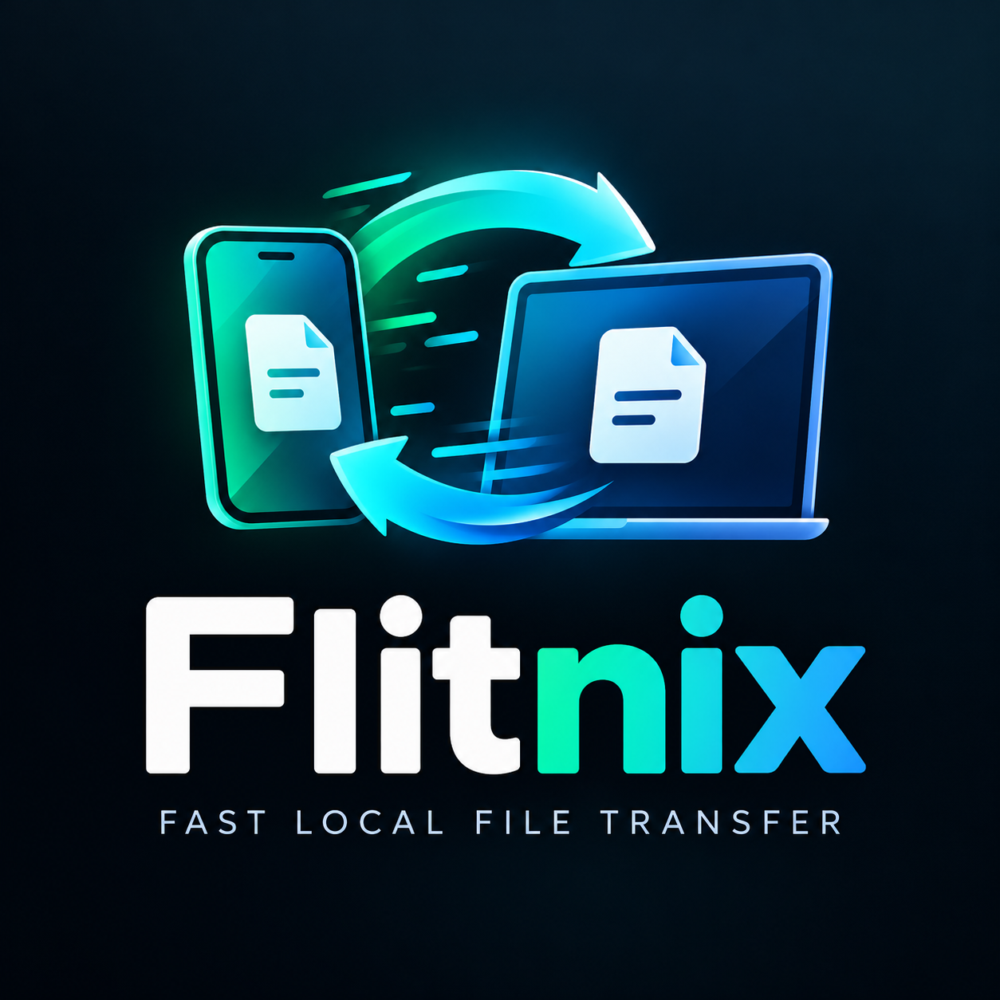

<p align="center">
  
</p>

<h1 align="center">Flitnix</h1>

<p align="center">
  <strong>Fast, private, local file transfer between your desktop and phone.</strong><br>
  No cloud relays. No accounts. No tracking. Pure local network speed.
</p>

<p align="center">
  <a href="https://github.com/RobinMillford/flitnix/actions/workflows/ci.yml">
    
  </a>
  <a href="https://github.com/RobinMillford/flitnix/releases">
    
  </a>
  <a href="LICENSE">
    
  </a>
  
  
  
</p>

---

## Overview

**Flitnix** is an offline-first desktop application that pairs with your smartphone browser via a local QR code. Send full-resolution photos, 4K videos, documents, or entire directories between your desktop and phone instantly over your local Wi-Fi or LAN—without installing any app on your mobile device.

Flitnix combines the performance and concurrency safety of Go with a modern Svelte 5 frontend and the native webview power of Wails v2.

---

## Key Features

- **No Mobile App Required**: Simply scan a QR code using your phone's camera. The transfer interface opens directly in Safari, Chrome, Firefox, or any modern mobile browser.
- **Pure Local Network (Zero Cloud)**: All transfers stream directly between your devices on the local subnet. Your files never touch external servers or cloud relays.
- **Two-Way Transfers**: Send files from phone to desktop with real-time progress, or drop desktop files onto Flitnix to download them on your phone.
- **Rock-Solid Reliability**:
  - Two-phase publication reservation ensures cancellation requests and successful disk commits never produce corrupted or ghost files.
  - Safe session teardown prevents revoked sessions or network drops from leaving dangling locks or orphaned temporary files.
  - Automated network adapter discovery with native Wi-Fi SSID identification on Linux, Windows, and macOS.
- **Lightweight & Fast**: Built with Go and native webview technologies for minimal memory footprint and blistering LAN transfer speeds.

---

## Installation

### One-Command Quick Install

#### Linux and macOS (POSIX sh)
```bash
curl -fsSL https://raw.githubusercontent.com/RobinMillford/flitnix/main/install.sh | sh
```

*Inspect-first option:*
```bash
curl -fsSL https://raw.githubusercontent.com/RobinMillford/flitnix/main/install.sh -o install.sh
less install.sh
sh install.sh
```

The installer automatically detects your operating system, CPU architecture, and distribution package manager (`.deb`, `.rpm`, or `.tar.gz`), verifies SHA-256 checksums, and installs the application.

#### Windows (PowerShell)
Open PowerShell and run:
```powershell
irm https://raw.githubusercontent.com/RobinMillford/flitnix/main/install.ps1 | iex
```

*Inspect-first option:*
```powershell
Invoke-WebRequest -Uri https://raw.githubusercontent.com/RobinMillford/flitnix/main/install.ps1 -OutFile install.ps1
Get-Content install.ps1 | more
.\install.ps1
```

---

### Manual Downloads

Official standalone binaries and packages are available on the [Releases page](https://github.com/RobinMillford/flitnix/releases):

| Operating System | Package Format | Architecture | Description |
| :--- | :--- | :--- | :--- |
| **Linux (Fedora, RHEL, CentOS, openSUSE)** | `.rpm` | `x86_64` | Native RPM package with desktop integration & icons |
| **Linux (Debian, Ubuntu, Mint, Pop!_OS)** | `.deb` | `amd64` | Native Debian package with desktop integration & icons |
| **Linux (Generic / Arch / Void / Alpine)** | `.tar.gz` | `x86_64` | Standalone archive with automated install script |
| **Windows (10 / 11)** | `.exe` | `x64` | Setup installer with desktop shortcut and uninstaller |
| **macOS (11+ Big Sur through Sequoia)** | `.dmg` | Universal | Disk Image with drag-and-drop `/Applications` install |
| **macOS (11+ Portable)** | `.zip` | Universal | Standalone compressed application bundle |

Every release includes a verified `SHA256SUMS.txt` manifest.

---

## Platform Compatibility

| Platform | Minimum Version | Runtime Requirements |
| :--- | :--- | :--- |
| **Linux** | Fedora 39+, Ubuntu 22.04+, Debian 12+, Arch Linux | `libwebkit2gtk-4.1` (or `4.0`) and `libgtk-3-0` |
| **Windows** | Windows 10 (1809+) / Windows 11 (64-bit) | Microsoft Edge WebView2 Runtime (included in Windows 10/11) |
| **macOS** | macOS 11.0 Big Sur or later | Universal binary (native on Apple Silicon M-series and Intel) |
| **Phone** | iOS 14+ (Safari), Android 8+ (Chrome, Firefox, etc.) | Any browser supporting Fetch API and WebSockets on the same Wi-Fi |

---

## Architecture & Security

```
+-------------------------------------------------------------+
|                         Desktop                             |
|  +--------------------+         +------------------------+  |
|  |   Svelte 5 UI      |         |   Local HTTP/WS Server |  |
|  | (Dark Navy / Cyan) | <-----> |   (Go stdlib + Wails)  |  |
|  +--------------------+         +------------------------+  |
+---------------------------------------------^---------------+
                                              |
                          Local Wi-Fi / LAN   | (No Cloud Relay)
                                              v
                                  +-----------------------+
                                  |     Phone Browser     |
                                  | (Mobile Web Transfer) |
                                  +-----------------------+
```

1. **Ephemeral Local Sessions**: Each pairing generates a cryptographic session token. Unauthenticated requests from outside devices are rejected.
2. **Atomic Publication Guarantee**: Incoming uploads stream into temporary staging files. Files are verified and atomically moved into your target folder only when complete.
3. **Publication-Reservation Race Protection**: If a cancellation arrives while a write is committing to disk, Flitnix preserves the invariant that successfully published files remain marked as completed.
4. **No External Network Dependencies**: Flitnix does not communicate with external analytics services, telemetry collectors, or third-party servers.

---

## Development & Building

### Prerequisites

- [Go](https://golang.org/) 1.24+ (1.27+ recommended)
- [Node.js](https://nodejs.org/) 22+ & npm
- [Wails v2](https://wails.io/): `go install github.com/wailsapp/wails/v2/cmd/wails@latest`
- Linux build dependencies (Fedora: `sudo dnf install gtk3-devel webkit2gtk4.1-devel`; Ubuntu: `sudo apt install libgtk-3-dev libwebkit2gtk-4.1-dev`)

### Live Development

Run live development with hot module reloading:

```bash
# On Fedora/modern Linux:
wails dev -tags webkit2_41

# On Windows / macOS:
wails dev
```

### Production Build

```bash
# Linux
wails build -tags webkit2_41

# Windows (with NSIS installer)
wails build -nsis

# macOS
wails build
```

### Running Tests

```bash
# Go unit and integration tests
go test -count=1 ./...

# Concurrency race detector on transfer & server packages
go test -race ./internal/transfer ./internal/server .

# Frontend unit tests and type checks
cd frontend
npm test
npm run check
```

For detailed test coverage information and subsystem test layouts, see the [Test Suite Index & Guide](tests/README.md).

---

## Project Documentation

- [Contributing Guidelines](CONTRIBUTING.md) — How to develop, submit bug reports, and create pull requests.
- [Security Policy](SECURITY.md) — How to report security vulnerabilities responsibly.
- [Changelog](CHANGELOG.md) — Version history and release notes.
- [Test Suite Guide](tests/README.md) — Comprehensive guide to the test architecture.

---

## License

Flitnix is licensed under the [Apache License, Version 2.0](LICENSE).
See the [`LICENSE`](LICENSE) file for the full license text and [`NOTICE`](NOTICE) for third-party font and software notices.
