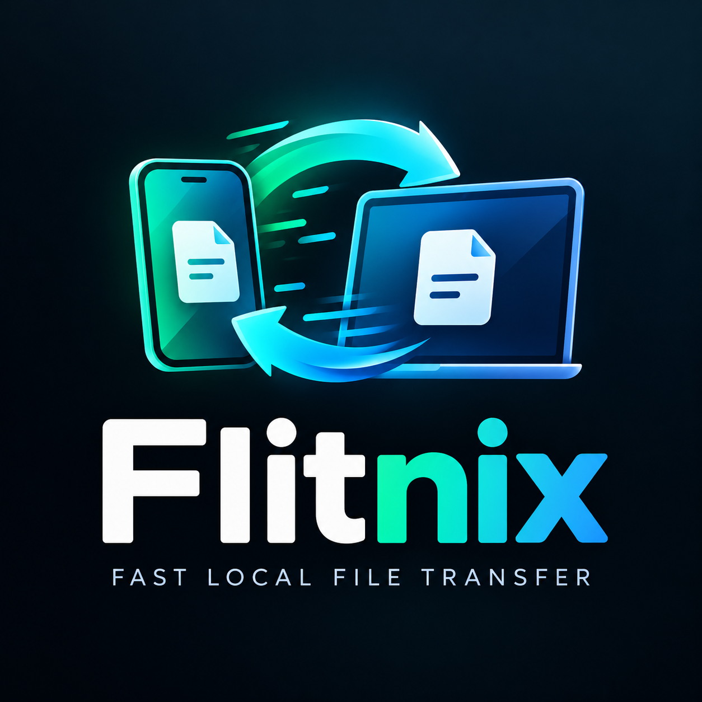

<p align="center">
  
</p>

<h1 align="center">Flitnix</h1>

<p align="center">
  <strong>Fast, private, local file transfer between your desktop and phone.</strong><br>
  No cloud relays. No accounts. No tracking. Pure local network speed.
</p>

<p align="center">
  <a href="https://github.com/RobinMillford/flitnix/actions/workflows/ci.yml">
    
  </a>
  <a href="https://github.com/RobinMillford/flitnix/releases">
    
  </a>
  <a href="LICENSE">
    
  </a>
  
  
  
</p>

---

## Overview

**Flitnix** is an offline-first desktop application that pairs with your smartphone browser via a local QR code. Send full-resolution photos, 4K videos, documents, or entire directories between your desktop and phone instantly over your local Wi-Fi or LAN—without installing any app on your mobile device.

Flitnix combines the performance and concurrency safety of Go with a modern Svelte 5 frontend and the native webview power of Wails v2.

---

## Key Features & What's New in v2.7

Flitnix provides high-speed, private local file transfers between desktop computers and phones. Version **v2.7** brings major reliability, security, and recovery improvements across the transfer engine:

- **Direct High-Speed Streaming Uploads**:
  - High-throughput, single-pass HTTP streaming directly from browser storage to desktop with zero whole-file memory buffering.
  - Incremental single-pass SHA-256 integrity verification hashes data on the fly during the write pass without duplicate reads or storage synchronization stalls.
  - Sequential transfer queue preserving low CPU and RAM consumption on phones and laptops.
  - Clean restart from byte zero: if a connection is interrupted or fails, incomplete temporary files are safely aborted and discarded; retrying starts a fresh transfer allocation from byte zero without complex or fragile partial-offset reconciliation.
- **Guest Drop Box (Multi-Device Upload Room)**:
  - Collect photos, videos, and documents from an entire group, classroom, or meeting without requiring anyone to install an app.
  - Guests scan a single QR code with their phone camera to request entry.
  - Dual host-approval gates: approve guests to join, then approve incoming files before they are accepted.
  - Strict destination isolation: each guest's uploads are placed in their own private subfolder (`Flitnix Guest Drop/<Room>/<Guest>/`).
  - Upload-only security: guests cannot see or download files shared by the host or other guests.
- **Hardened Pairing & Device Security**:
  - Ephemeral token exchange and local pairing verification with exponential lockout backoff after repeated failed attempts.
  - Device name sanitization strips ANSI escape sequences, control characters, and Unicode bidi overrides.
  - Path traversal protection and Windows reserved device name rejection (`CON`, `PRN`, `AUX`, `NUL`, `COM1..9`, `LPT1..9`, and trailing dots/spaces).
- **Safe File Publication & Collision Handling**:
  - Two-phase staging with atomic publication ensures incomplete, cancelled, or corrupted streams never leave phantom or corrupted files.
  - Automatic collision-avoidance numbering preserves existing destination files without accidental overwrites.
- **Smoothed, Efficient Progress Reporting**:
  - Time-throttled progress updates (~50 ms interval) reduce UI event overhead by over 99% during gigabyte-scale transfers while ensuring immediate 100% completion delivery.
  - Rolling delta Exponential Moving Average (EMA) speed calculation eliminates erratic Wi-Fi throughput spikes with real-time ETA estimates.
- **Connection Doctor & Quick Text**:
  - One-click desktop diagnostics resolving connectivity issues between mobile devices and your computer.
  - Runs 7 automated checks: network adapter presence, IPv4 address validation, port 43821 availability, `/healthz` HTTP loopback probe, Wi-Fi client isolation warnings, host binding reachability, and multi-homed routing guidance.
  - Instant, bidirectional note and URL sharing strictly bounded to 64 KiB with UTF-8 validation, HTML neutralization, and protocol guards (`http://` and `https://` only).
- **No Mobile App Required & Zero Cloud**:
  - The mobile interface runs in any modern browser (Safari, Chrome, Firefox) without App Store downloads or user accounts.
  - All transfers stream directly over your local Wi-Fi or mobile hotspot. No external cloud relays or tracking.

---

## Installation

### One-Command Quick Install

#### Linux and macOS (POSIX sh)
```bash
curl -fsSL https://raw.githubusercontent.com/RobinMillford/flitnix/main/install.sh | sh
```

*Inspect-first option:*
```bash
curl -fsSL https://raw.githubusercontent.com/RobinMillford/flitnix/main/install.sh -o install.sh
less install.sh
sh install.sh
```

The installer automatically detects your operating system, CPU architecture, and distribution package manager (`.deb`, `.rpm`, or `.tar.gz`), verifies SHA-256 checksums, and installs the application.

#### Windows (PowerShell)
Open PowerShell and run:
```powershell
irm https://raw.githubusercontent.com/RobinMillford/flitnix/main/install.ps1 | iex
```

*Inspect-first option:*
```powershell
Invoke-WebRequest -Uri https://raw.githubusercontent.com/RobinMillford/flitnix/main/install.ps1 -OutFile install.ps1
Get-Content install.ps1 | more
.\install.ps1
```

---

### Manual Downloads

Official standalone binaries and packages are available on the [Releases page](https://github.com/RobinMillford/flitnix/releases):

| Operating System | Package Format | Architecture | Description |
| :--- | :--- | :--- | :--- |
| **Linux (Fedora, RHEL, CentOS, openSUSE)** | `.rpm` | `x86_64` | Native RPM package with desktop integration & icons |
| **Linux (Debian, Ubuntu, Mint, Pop!_OS)** | `.deb` | `amd64` | Native Debian package with desktop integration & icons |
| **Linux (Generic / Arch / Void / Alpine)** | `.tar.gz` | `x86_64` | Standalone archive with automated install script |
| **Windows (10 / 11)** | `.exe` | `x64` | Setup installer with desktop shortcut and uninstaller |
| **macOS (11+ Big Sur through Sequoia)** | `.dmg` | Universal | Disk Image with drag-and-drop `/Applications` install |
| **macOS (11+ Portable)** | `.zip` | Universal | Standalone compressed application bundle |

Every release includes a verified `SHA256SUMS.txt` manifest.

---

## Platform Compatibility & Project Status

### Flitnix v2.7 Project & Release Status

| Platform / Target | Minimum Version | Status | Verification & Readiness Notes |
| :--- | :--- | :--- | :--- |
| **Linux (Desktop)** | Fedora 39+, Ubuntu 22.04+, Debian 12+, Arch Linux | **Locally Verified** | Full test suite and race detector clean; native packaging (`.deb`, `.rpm`, `.tar.gz`) locally built and verified; single-pass direct streaming engine active. |
| **Windows (Desktop)** | Windows 10 (1809+) / Windows 11 (64-bit) | **CI Pending** | Single-pass streaming and atomic collision-safe publication verified; local repeated tests pass (50/50); remote Windows GitHub Actions CI confirmation pending. Authenticode code signing pending. |
| **macOS (Desktop)** | macOS 11.0 Big Sur or later | **Native Validation Pending** | Universal binary configuration present (`.dmg` / `.zip`); direct streaming upload engine cross-compiled; native hardware execution, code signing, and notarization pending. |
| **Mobile Browsers** | iOS 14+ (Safari), Android 8+ (Chrome, Firefox, etc.) | **Automated Tests Passed** | Direct single-pass HTTP streaming with native progress reporting and wake-lock test suites pass; physical mobile device validation across diverse hardware pending. |
| **Physical RF Wi-Fi & Power Loss** | All Platforms | **Deferred** | Physical multi-room RF Wi-Fi roaming, AP handoff, and hardware sudden power-loss testing are explicitly deferred to post-v2.7 evaluation tracks. |

---

## Architecture & Security

```
+-------------------------------------------------------------+
|                         Desktop                             |
|  +--------------------+         +------------------------+  |
|  |   Svelte 5 UI      |         |   Local HTTP/WS Server |  |
|  | (Dark Navy / Cyan) | <-----> |   (Go stdlib + Wails)  |  |
|  +--------------------+         +------------------------+  |
+---------------------------------------------^---------------+
                                              |
                          Local Wi-Fi / LAN   | (No Cloud Relay)
                                              v
                                  +-----------------------+
                                  |     Phone Browser     |
                                  | (Mobile Web Transfer) |
                                  +-----------------------+
```

1. **Ephemeral Local Sessions**: Each pairing generates a cryptographic session token. Unauthenticated requests from outside devices are rejected.
2. **Atomic Publication Guarantee**: Incoming uploads stream into temporary staging files. Files are verified and atomically moved into your target folder only when complete.
3. **Publication-Reservation Race Protection**: If a cancellation arrives while a write is committing to disk, Flitnix preserves the invariant that successfully published files remain marked as completed.
4. **No External Network Dependencies**: Flitnix does not communicate with external analytics services, telemetry collectors, or third-party servers.

---

## Development & Building

### Prerequisites

- [Go](https://golang.org/) 1.24+ (1.27+ recommended)
- [Node.js](https://nodejs.org/) 22+ & npm
- [Wails v2](https://wails.io/): `go install github.com/wailsapp/wails/v2/cmd/wails@latest`
- Linux build dependencies (Fedora: `sudo dnf install gtk3-devel webkit2gtk4.1-devel`; Ubuntu: `sudo apt install libgtk-3-dev libwebkit2gtk-4.1-dev`)

### Live Development

Run live development with hot module reloading:

```bash
# On Fedora/modern Linux:
wails dev -tags webkit2_41

# On Windows / macOS:
wails dev
```

### Production Build

```bash
# Linux
wails build -tags webkit2_41

# Windows (with NSIS installer)
wails build -nsis

# macOS
wails build
```

### Running Tests

```bash
# Go unit and integration tests
go test -count=1 ./...

# Concurrency race detector on transfer & server packages
go test -race ./internal/transfer ./internal/server .

# Frontend unit tests and type checks
cd frontend
npm test
npm run check
```

For detailed test coverage information and subsystem test layouts, see the [Test Suite Index & Guide](tests/README.md).

---

## Project Documentation

- [Architecture & Subsystem Design](docs/architecture.md) — Deep dive into Guest Drop Box, Connection Doctor, Quick Text, and reliability engines.
- [Contributing Guidelines](CONTRIBUTING.md) — How to develop, submit bug reports, and create pull requests.
- [Security Policy](SECURITY.md) — How to report security vulnerabilities responsibly.
- [Changelog](CHANGELOG.md) — Version history and release notes.
- [Test Suite Guide](tests/README.md) — Comprehensive guide to the test architecture.

---

## License

Flitnix is free software licensed under the [GNU Affero General Public License v3.0 only](LICENSE) (`SPDX: AGPL-3.0-only`). You can redistribute it and/or modify it under the terms of the GNU Affero General Public License as published by the Free Software Foundation, version 3 of the License. See the [`LICENSE`](LICENSE) file for the full license text and official terms, or visit <https://www.gnu.org/licenses/agpl-3.0.html>.

### Historical Releases & Apache 2.0 Compatibility

Historical releases of Flitnix (versions v0.1.0 through v0.2.5) were distributed under the [Apache License, Version 2.0](LICENSES/Apache-2.0.txt) and remain available under those terms. Rights previously granted under Apache 2.0 are preserved and not revoked. Components and contributions originating under Apache 2.0 remain governed by their applicable notices. The complete Apache 2.0 license text is preserved in [`LICENSES/Apache-2.0.txt`](LICENSES/Apache-2.0.txt).

### Third-Party Software & Font Notices

See the [`NOTICE`](NOTICE) file for third-party software, libraries, and font notices (including the Nunito font under the SIL Open Font License 1.1 and bundled libraries under permissive licenses).
