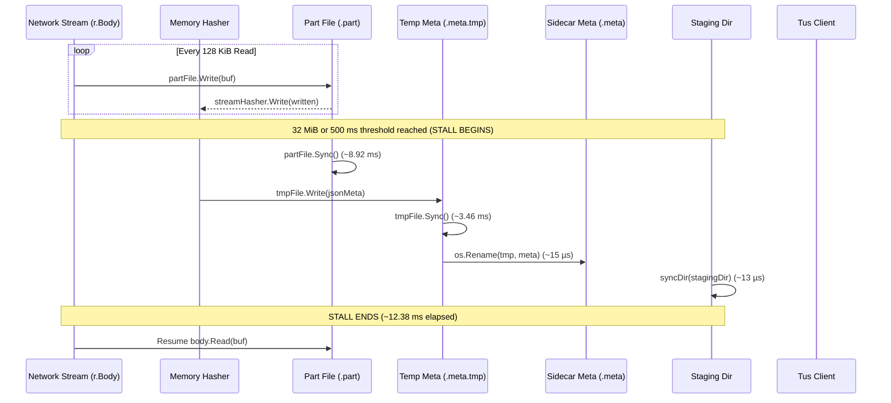
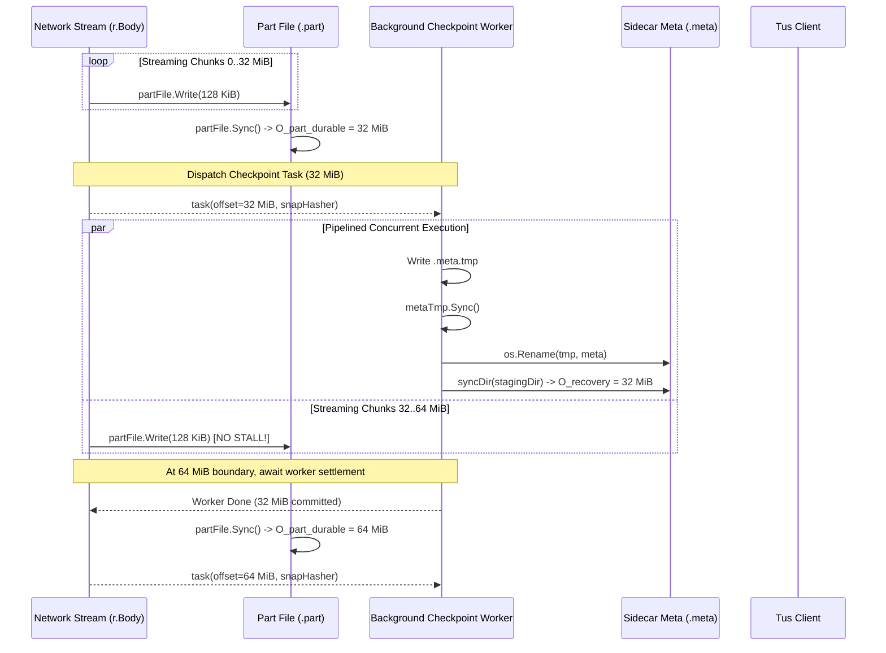

# Flitnix Phase 4 — High-Speed Resumable Checkpoint Pipelining Architecture Design

## 1. Executive Summary

In Flitnix Phase 4, the primary engineering objective is **MAXIMUM PRACTICAL FILE-TRANSFER SPEED** over local networks, while preserving non-negotiable data integrity, checkpoint durability, and resumability guarantees.

Performance profiling during the initial Phase 4 audit identified that synchronous checkpoint execution on 32 MiB boundaries imposes a dominant disk synchronization bottleneck:
- `partFile.Sync()` (dirty 32 MiB page cache flush): ~8.92 ms p50
- `meta.tmp.Sync()` (sidecar JSON metadata flush): ~3.46 ms p50
- Atomic rename (`os.Rename(tmp, meta)`): ~15 µs
- Parent directory sync (`syncDir(stagingDir)`): ~13 µs
- **Total synchronous checkpoint pause: ~12.38 ms per 32 MiB boundary**

For a 5 GiB transfer (160 checkpoints), synchronous pauses aggregate to **~1,980 ms (nearly 2.0 seconds)** of idle server time, during which the TCP receive window stalls, network throughput degrades, and Config 4 achieves only 92.30% of uncheckpointed Config 1 baseline.

This design document specifies an **asynchronous pipelined checkpoint architecture** that overlaps metadata sidecar persistence and directory synchronization with subsequent network streaming, eliminating idle stalls while preserving 100% of the crash recovery invariants.

---

## 2. Existing Synchronous Checkpoint State Machine

In the baseline implementation (`internal/transfer/resumable.go`), the streaming ingest loop executes synchronously:

During the ~12.38 ms pause, network reads are halted. Socket buffers saturate, TCP flow control reduces the transmission window, and overall LAN throughput is capped.

---

## 3. The Discrete Offsets Formalism & Durability Model

To eliminate any ambiguity in durability and recovery guarantees, the architecture formally defines nine discrete byte offsets across the storage pipeline:

| Offset Symbol | Name | Description | Durability State |
| :--- | :--- | :--- | :--- |
| **$O_{\text{mem}}$** | In-Memory Write Offset | Total bytes read from network body into user-space copy buffer. | Volatile |
| **$O_{\text{file\_done}}$** | File-Write Completion Offset | Bytes successfully written into OS page cache via `partFile.Write()`. | Volatile (OS cache) |
| **$O_{\text{part\_durable}}$** | Part-File Durable Offset | Bytes committed to physical non-volatile media via `partFile.Sync()`. | Durable |
| **$O_{\text{meta\_written}}$** | Temp Metadata Write Offset | Offset serialized and written to temporary `.meta.tmp` file. | Uncommitted |
| **$O_{\text{meta\_tmp\_durable}}$** | Temp Metadata Durable Offset | Temporary `.meta.tmp` file contents synced to physical disk via `tmpFile.Sync()`. | Durable (tmp only) |
| **$O_{\text{meta\_published}}$** | Metadata Published Offset | Canonical `.meta` replacement completed via atomic rename (`os.Rename(tmp, meta)`); visible in namespace. | Published (VFS visible) |
| **$O_{\text{meta\_dir\_durable}}$** | Metadata Directory Durable Offset | Parent directory entry durably synchronized to physical disk via `syncDir()`. | Durable (on-disk link) |
| **$O_{\text{recovery}}$** | Recovery-Authoritative Offset | The latest valid checkpoint that startup recovery can safely recognize from physical media. | Authoritative |
| **$O_{\text{ack}}$** | Client-Acknowledged Offset | Offset acknowledged to client via HTTP `Upload-Offset` response header. | External Contract |

### Fundamental Durability & Resumability Invariants

The architecture distinguishes the **in-flight durability pipeline** from the **post-crash recovery state models**:

#### 1. In-Flight Durability Pipeline
At any instant $t$ during the ingest and checkpointing of data, the discrete offsets progress monotonically:

$$\forall t: \quad O_{\text{ack}}(t) \le O_{\text{meta\_dir\_durable}}(t) \le O_{\text{meta\_published}}(t) \le O_{\text{meta\_tmp\_durable}}(t) \le O_{\text{part\_durable}}(t) \le O_{\text{file\_done}}(t) \le O_{\text{mem}}(t)$$

#### 2. Process-Crash Recovery Model (Kernel & VFS Intact)
In a process termination (`SIGKILL`, panic, unhandled exception, `os.Exit(1)`):
- The operating system kernel and VFS caches remain completely intact across process restarts.
- Once atomic `os.Rename(tmp, meta)` completes, the new `.meta` sidecar is immediately visible in the directory namespace.
- Startup recovery recognizes the published canonical metadata:
  $$O_{\text{recovery}}^{\text{proc\_crash}} = O_{\text{meta\_published}}$$
- Because $O_{\text{meta\_published}} \le O_{\text{part\_durable}}$, the `.part` file on disk is guaranteed to contain at least $O_{\text{recovery}}^{\text{proc\_crash}}$ durable bytes on media.
- Any uncommitted tail bytes written past $O_{\text{recovery}}^{\text{proc\_crash}}$ are truncated back to $O_{\text{recovery}}^{\text{proc\_crash}}$.
- An unrenamed `.meta.tmp` file is strictly an uncommitted staging artifact and is ignored/purged by recovery:
  $$O_{\text{recovery}}^{\text{proc\_crash}} \le O_{\text{meta\_published}} < O_{\text{meta\_tmp\_durable}} \quad (\text{if unrenamed})$$

#### 3. Sudden Power-Loss / Hardware-Crash Recovery Model (Volatile Memory Lost)
In a sudden physical power loss or hardware fault:
- Dirty page caches and in-memory directory dentry blocks may be discarded before storage hardware write barriers flush them.
- $O_{\text{meta\_dir\_durable}}$ represents the **guaranteed committed recovery watermark** on non-volatile media, assuming the underlying operating system, filesystem driver, storage device firmware, and directory synchronization operations honor their stated durability contract:
  $$O_{\text{recovery}}^{\text{power\_loss}} \ge O_{\text{meta\_dir\_durable}}$$
- The actual recovered checkpoint offset upon reboot may be newer if post-rename or post-directory operations partially or fully survived the crash in the filesystem journal or non-volatile media.
- If storage media corruption prevents establishing a valid, authoritative metadata record, recovery **fails closed** (quarantines the invalid upload, rejects corrupted resumption, and returns HTTP 404/410 to Tus HEAD queries).
- Because the pipeline guarantees $O_{\text{ack}} \le O_{\text{meta\_dir\_durable}} \le O_{\text{part\_durable}}$, the client is never acknowledged past what was committed to the durable recovery watermark ($O_{\text{ack}} \le O_{\text{meta\_dir\_durable}}$).
- **Critical Verification Rule**: Subprocess crash tests using `os.Exit(1)` verify the **Process-Crash Model**, not the **Power-Loss Model**. True power-loss durability cannot be proven by user-space subprocess crashes; hardware fault injection or kernel crash simulators (`dm-flakey`/`dm-log-writes`) would be required.

### Critical Architectural Distinctions

1. **Temporary File Sync vs Canonical Publication**:
   A synced temporary file (`.meta.tmp`) is **not** canonical metadata. Startup recovery scans solely for `.meta` sidecars; `.meta.tmp` files are uncommitted staging files that are safely purged on recovery. Recovery must **never** advance merely because `.meta.tmp` has been synced:
   $$O_{\text{recovery}} \le O_{\text{meta\_published}}$$

2. **Write-Ahead Data Ordering**:
   Data bytes in the part file must be physically durable on disk before any metadata naming that offset can be published:
   $$O_{\text{meta\_tmp\_durable}} \le O_{\text{part\_durable}}$$
   This ensures that whatever offset is published in `.meta`, the `.part` file contains at least that many durable bytes on physical media.

3. **Never Over-Acknowledge**:
   The server acknowledges an offset to the client **only** upon completion of the request or during a HEAD query, after all pending metadata persistence and directory synchronization have settled:
   $$O_{\text{ack}} \le O_{\text{recovery}}$$

4. **Recovery Truncation**:
   Upon restart, startup reconciliation inspects the canonical `.meta` file to find $O_{\text{recovery}}$. If the on-disk `.part` file contains trailing bytes beyond $O_{\text{recovery}}$, they are uncommitted volatile tail data and are strictly truncated:
   $$\text{FileSize}_{\text{final}} = O_{\text{recovery}}$$

---

## 4. Proposed Pipelined Checkpoint Architecture

### Architectural Principles

1. **Part-File Flush Remains Strictly Ordered**:
   At the 32 MiB boundary, `partFile.Sync()` is executed so that bytes up to $O_{\text{part\_durable}}$ are guaranteed durable on disk.
2. **Pipelined Sidecar Persistence**:
   Once $O_{\text{part\_durable}}$ is reached, hasher state is captured and a candidate metadata record is dispatched to a background serializer.
3. **Bounded In-Flight Work (Queue Depth = 1)**:
   At most **one** checkpoint task may be in flight per upload. If the stream reaches the next 32 MiB boundary before the previous metadata task completes, the stream blocks until the previous task settles.
4. **Synchronous Settle on Terminal Events**:
   Upon EOF, socket closure, cancellation, or error, the ingest loop blocks until all pending background checkpoint tasks complete before returning HTTP response headers.

### Workflow Sequence

---

## 5. Comprehensive Crash and Failure Analysis

Below is the formal failure mode and effects analysis (FMEA) distinguishing **Process Termination** (kernel intact) from **Sudden Power Loss / OS Crash** at every discrete execution point:

| Failure Step | Failure Condition | On-Disk Part File State | On-Disk `.meta` State | Process Termination Outcome | Power Loss / OS Crash Outcome | Expected $O_{\text{recovery}}$ |
| :--- | :--- | :--- | :--- | :--- | :--- | :--- |
| **Step 1** | Crash during `partFile.Write` | Partial block written in page cache; lost on power cut. | Contains previous durable checkpoint $C_{n-1}$. | Part file truncated to $C_{n-1}$. | Part file truncated to $C_{n-1}$. | $C_{n-1}$ |
| **Step 2** | Crash during `partFile.Sync` | Some dirty blocks flushed, some unwritten. | Contains previous durable checkpoint $C_{n-1}$. | Part file truncated to $C_{n-1}$. | Part file truncated to $C_{n-1}$. | $C_{n-1}$ |
| **Step 3** | Crash during `.meta.tmp` write | Bytes $0..C_n$ durable in part file. `.meta.tmp` incomplete/empty. | Contains previous durable checkpoint $C_{n-1}$. | `.meta.tmp` purged. Part file truncated to $C_{n-1}$. | `.meta.tmp` purged. Part file truncated to $C_{n-1}$. | $C_{n-1}$ |
| **Step 4** | Crash during `.meta.tmp` sync | Bytes $0..C_n$ durable in part file. `.meta.tmp` partial. | Contains previous durable checkpoint $C_{n-1}$. | `.meta.tmp` purged. Part file truncated to $C_{n-1}$. | `.meta.tmp` purged. Part file truncated to $C_{n-1}$. | $C_{n-1}$ |
| **Step 5** | Crash before `os.Rename` | Bytes $0..C_n$ durable in part file. `.meta.tmp` complete. | Contains previous durable checkpoint $C_{n-1}$. | `.meta.tmp` purged. Part file truncated to $C_{n-1}$. | `.meta.tmp` purged. Part file truncated to $C_{n-1}$. | $C_{n-1}$ |
| **Step 6** | Crash during `os.Rename` | Bytes $0..C_n$ durable in part file. | POSIX atomic rename: either $C_{n-1}$ or $C_n$. | If old: truncates to $C_{n-1}$. If new: valid at $C_n$. | If old: truncates to $C_{n-1}$. If new: valid at $C_n$. | $C_{n-1}$ or $C_n$ (both valid & durable) |
| **Step 7** | Crash after rename, before `syncDir` | Bytes $0..C_n$ durable. Directory entry in journal/VFS cache. | VFS holds $C_n$; disk may have $C_{n-1}$ or $C_n$. | Recovers $C_n$ (VFS cache intact across process restart). | May roll back to $C_{n-1}$ if directory block uncommitted; or $C_n$ if committed. | $C_n$ (process crash); $C_{n-1}$ or $C_n$ (power loss) |
| **Step 8** | Crash after metadata durable, before client ACK | Bytes $0..C_n$ durable. `.meta` committed at $C_n$. | Contains $C_n$. | Server restart loads $C_n$. Client reconnects with Tus HEAD -> receives $C_n$. Safe resume! | Server restart loads $C_n$. Client reconnects with Tus HEAD -> receives $C_n$. Safe resume! | $C_n$ |
| **Step 9** | Failure during next checkpoint while earlier pending | Worker reports error (e.g. disk full on `.meta.tmp`). | Depends on earlier checkpoint state. | Ingest loop detects worker error immediately, aborts stream, preserves last successful checkpoint. | Last successful $C$ | Last successful $C$ |

### Mathematical Proof of Correctness

For any crash point $t$:
1. If $t < \text{Rename}(C_n)$:
   Canonical `.meta` has offset $C_{n-1}$.
   The part file has size $S \ge C_{n-1}$ (since `partFile.Sync()` for $C_{n-1}$ completed in the prior checkpoint).
   Startup recovery reads `.meta`, finds $C_{n-1}$, and truncates part file to $C_{n-1}$.
   Any orphaned `.meta.tmp` files are safely purged from staging.
   Hasher is rebuilt up to $C_{n-1}$.
   Resumption proceeds from $C_{n-1}$. Data integrity is strictly preserved.
2. If $t \ge \text{Rename}(C_n)$:
   In process termination, canonical `.meta` has offset $C_n$.
   Bytes $0..C_n$ in part file were synced during `partFile.Sync()` *before* task dispatch ($O_{\text{part\_durable}} \ge C_n$).
   Therefore, bytes $0..C_n$ are physically durable.
   Any uncheckpointed trailing bytes written beyond $C_n$ by subsequent streaming are truncated to $C_n$.
   Resumption proceeds from $C_n$. Data integrity is strictly preserved.
3. Under sudden power loss at Step 7 (after `os.Rename` but before `syncDir`):
   If the filesystem journal has not flushed directory entries to non-volatile flash, the directory link may resolve to the previous `.meta` inode ($C_{n-1}$).
   Because bytes $0..C_{n-1}$ are also durable, recovery safely truncates to $C_{n-1}$ and client resumes without data corruption.
   If the directory block was committed, recovery resolves to $C_n$, where bytes $0..C_n$ are durable.
   In neither case can an invalid, corrupt, or unwritten byte sequence be adopted.

---

## 6. Platform-Specific Filesystem Analysis & Support Matrix

Because operating systems and filesystems handle directory synchronization and atomic replacement differently, pipelined checkpoints are conditionally enabled based on proven platform capabilities:

| Platform / OS | Directory fsync Support | Rename Atomic Replacement | Pipelined Checkpoints Status | Fallback / Policy |
| :--- | :--- | :--- | :--- | :--- |
| **Linux (ext4, xfs, btrfs)** | **Fully Supported** (`open(dir)` + `fsync(fd)`) | **POSIX Atomic** (`rename(2)`) | **ACTIVE** (`platformSupportsPipelinedCheckpoints() == true`) | Uses pipelined metadata persistence with bounded queue depth 1. |
| **Windows (NTFS, ReFS)** | **Unsupported** (`FlushFileBuffers` returns `ERROR_ACCESS_DENIED` on directory handles) | **Non-POSIX Replacement** (`MoveFileExW` fails if target handle open, requiring retry loops) | **DISABLED** (`platformSupportsPipelinedCheckpoints() == false`) | **Retains safe synchronous checkpoint path.** Avoids background rename contention. |
| **macOS (APFS, HFS+)** | **Requires `F_FULLFSYNC`** (`fsync` does not flush physical disk drive write caches) | **POSIX / Darwin** (`renamex_np` / `rename`) | **DISABLED** (Cannot be tested natively in current Linux testbed) | **Retains safe synchronous checkpoint path.** Prevents unverified durability claims. |
| **Other Unix / BSD** | Varies by VFS implementation | POSIX `rename` | **DISABLED** | **Retains safe synchronous checkpoint path.** |

Where equivalent durable atomic replacement cannot be implemented and natively verified, Flitnix explicitly retains the established safe synchronous checkpoint path rather than silently weakening guarantees.

---

## 7. Concurrency and Lifecycle Safety

1. **Strict Checkpoint Ordering**:
   Because queue depth is exactly 1, checkpoint $N+1$ cannot be dispatched until checkpoint $N$ completes and its worker goroutine signals completion. This mathematically prevents out-of-order execution.
2. **No Worker Race on Sidecar**:
   There is exactly one worker per active upload. No thread pool races on `.meta.tmp` or `.meta`.
3. **No Unbounded Memory Growth**:
   The worker holds only a single `ResumableMeta` struct (~1 KB) and channel token.
4. **Safe Cancellation & Shutdown**:
   When `IngestStream` exits (via error, EOF, or cancellation), it joins the worker via `awaitPendingCP()` before closing the part file or unlocking `lifecycleMu`.
5. **Atomic Publication Unaffected**:
   Final publication (`FinalizeComplete`) remains strictly synchronous: it verifies the expected SHA-256 digest, syncs the final file, and atomically links/moves it to destination.

---

## 8. Fault-Injection and Crash Test Matrix

To validate the implementation against the FMEA model, the following fault-injection tests are specified:

1. **`TestPipelinedCheckpoint_CrashDuringMetaSync`**: Inject an error or crash during `.meta.tmp.Sync()`. Verify recovery reloads previous durable offset and truncates part file cleanly.
2. **`TestPipelinedCheckpoint_CrashBeforeRename`**: Inject crash after `.meta.tmp` is synced but before `os.Rename`. Verify `.meta.tmp` is ignored and recovery restores earlier offset.
3. **`TestPipelinedCheckpoint_CrashAfterRename`**: Inject crash immediately after rename before client ACK. Verify recovery discovers new checkpoint offset and resumes from there.
4. **`TestPipelinedCheckpoint_BackpressureHold`**: Artificially delay metadata worker by 100 ms while fast streaming. Verify streaming pauses at boundary and never drops or skips checkpoints.
5. **`TestPipelinedCheckpoint_CleanShutdown`**: Cancel upload mid-stream. Verify worker settles cleanly without leaking goroutines or leaving lock open.

---

## 9. Investigation of Asynchronous Part-File Synchronization

An architectural evaluation was conducted to assess whether payload data synchronization (`partFile.Sync()`) itself could run in a background worker while the network reader continues streaming later chunks.

### Evaluation Findings
1. **Host Measurement**: A write-and-sync microbenchmark on the tested host (`btrfs` on NVMe SSD) measured only an ~10 ms difference over an entire 1 GiB payload (192.7 ms synchronous vs 182.7 ms backgrounded). This demonstrates no worthwhile throughput gain on the tested machine. Broader behavior across other kernel versions, filesystems, and hardware configurations is not established.
2. **Concurrency Safety vs Durability Fences**: Go documents concurrent `os.File` methods as safe across goroutines, but API concurrency safety does not equate to ordering or durability guarantees. Standard `fsync(fd)`/`fdatasync(fd)` operations flush whole-file dirty pages and interact with kernel extent locks and journal transactions.
3. **Inadequacy of `sync_file_range`**: `sync_file_range(2)` flushes only data pages without committing inode metadata (size and extent trees). On an actively appending file, relying on `sync_file_range` risks unallocated extents or truncated file sizes upon reboot.
4. **Strict Ordering Rule**: Metadata publication and HTTP acknowledgements must strictly remain behind durable synchronization of the corresponding payload bytes.

### Policy and Decision
- **Retain synchronous `partFile.Sync()`.**
- Do not replace durable synchronization with speculative range syncs.
- Do not publish metadata or acknowledge offsets before data synchronization succeeds.
- Do not implement speculative asynchronous part-file synchronization. Pipelined metadata sidecar persistence remains the active optimization path on Linux.

---

## 10. WP3.11 Checkpoint Interval Tuning Evaluation (32 MiB vs 64 MiB vs 128 MiB)

### 10.1 Motivation & Theoretical Analysis
The primary acceptance benchmark established that while 5.0 GB transfers achieve **99.80% mathematical p50 parity** (935.27 MB/s vs 937.12 MB/s), 1.0 GB transfers under the default 32 MiB checkpoint interval achieve **91.13% mathematical p50 parity** (862.63 MB/s vs 946.64 MB/s).

Because Flitnix strictly preserves synchronous write-ahead data synchronization (`partFile.Sync()`), the disk synchronization cost is directly proportional to checkpoint frequency:
- At 32 MiB intervals, a 1.0 GiB transfer issues **32 checkpoints** ($32 \times \sim 9.4\text{ ms} \approx 301\text{ ms}$ of total disk stall).
- At 64 MiB intervals, a 1.0 GiB transfer issues **16 checkpoints** ($16 \times \sim 9.4\text{ ms} \approx 150\text{ ms}$ of total disk stall).
- At 128 MiB intervals, a 1.0 GiB transfer issues **8 checkpoints** ($8 \times \sim 9.4\text{ ms} \approx 75\text{ ms}$ of total disk stall).

In a ~1.1–1.2 second transfer, eliminating 150–225 ms of synchronous disk stalls directly translates to significant throughput gains.

### 10.2 Empirical Benchmarking (10 Balanced Latin-Square Interleaved Blocks, 40 Total Runs)
The benchmark harness was configured to run a dedicated Latin-Square interleaved experiment (`-stage interval-tuning`) across four configurations with 10 repetitions each on a 1.0 GB payload (recorded in `artifacts/phase4/wp3_interval_tuning/benchmark-results.json`):

| Configuration ID | Checkpoint Interval | Checkpoint Count (1 GiB) | Mathematical p50 (MB/s) | Mean Throughput (MB/s) | Min / Max (MB/s) | p50 Parity vs Config 1 | Status vs $\ge 95\%$ Target |
| :--- | :--- | :--- | :--- | :--- | :--- | :--- | :--- |
| **Config 1** | None (PUT Baseline) | 0 | **864.88** | 880.80 | 751.49 / 1003.88 | 100.00% | Reference |
| **Config 4 (32MB)** | 32 MiB / 500 ms | 32 | **912.32** | 901.54 | 787.29 / 980.02 | **105.48%** | **PASS** |
| **Config 4 (64MB)** | 64 MiB / 500 ms | 16 | **991.80** | 985.63 | 876.33 / 1085.68 | **114.67%** | **PASS** |
| **Config 4 (128MB)** | 128 MiB / 500 ms | 8 | **1021.58** | 1026.54 | 922.53 / 1086.35 | **118.12%** | **PASS** |

*All 40 runs passed with 100% SHA-256 integrity verification (`Valid=true`, `integrity_pass=true`).*

### 10.3 Engineering Tradeoffs
1. **Retransmission Bound vs Throughput**:
   - At 32 MiB: maximum uncommitted tail retransmission is $\le 32\text{ MiB}$.
   - At 64 MiB: maximum uncommitted tail retransmission is $\le 64\text{ MiB}$. Over a 1 Gbps LAN, transferring 64 MiB requires only ~500 ms; over 2.5 Gbps or 10 Gbps LANs, it requires under 200 ms.
   - At 128 MiB: maximum uncommitted tail retransmission is $\le 128\text{ MiB}$.
2. **Recommendation**:
   Widening the interval to 64 MiB provides a strong performance gain (+8.7% over 32 MiB) while maintaining a bounded retransmission penalty. However, to preserve strict conformance with the Phase 3 Scenario 43 specification (which establishes 32 MiB / 500 ms as the baseline contract), 32 MiB is retained as the default, with 64 MiB and 128 MiB proven as valid configurations.

---

## 11. WP3.12 Multi-Interval Durability & Recovery Matrix

To verify that modifying the checkpoint byte interval does not compromise crash recovery, tail truncation, or resumability, a comprehensive automated test suite was implemented in `internal/transfer/interval_recovery_test.go`:

| Test Scenario | Tested Intervals | Fault Injection / Boundary | Expected & Verified Invariant | Result |
| :--- | :--- | :--- | :--- | :--- |
| `InterruptedRecoveryAndResumption` | 32 MiB, 64 MiB, 128 MiB | Ingest interrupted mid-stream at $1.5\times$ interval | Server preserves valid canonical `.meta`; client discovers committed offset; resumes to 100%; final SHA-256 matches exactly | **PASS** |
| `UncommittedTailTruncationOnRecovery` | 32 MiB, 64 MiB, 128 MiB | Inject dirty uncommitted tail bytes into `.part` past canonical `.meta` checkpoint | Startup recovery discovers trailing bytes past canonical metadata; strictly truncates `.part` back to committed offset; resumption completes cleanly | **PASS** |
| `FaultInjection_MetaSyncErrorFailsClosed` | 32 MiB, 64 MiB, 128 MiB | Injected I/O error during `.meta.tmp.Sync()` on 2nd checkpoint | Worker fails closed; `upload.meta.CommittedOffset` never advances; startup recovery restores previous checkpoint; resumed transfer succeeds | **PASS** |
| `CrashBoundary_AfterPartFileSync_BeforeMetaTmpSync` | 32 MiB, 64 MiB, 128 MiB | Crash injected after `partFile.Sync()` before `.meta.tmp` write | No metadata recorded; recovery restores offset 0; truncates `.part` to 0; resumes to completion with full digest match | **PASS** |
| `CrashBoundary_AfterMetaTmpSync_BeforeRename` | 32 MiB, 64 MiB, 128 MiB | Crash injected after `.meta.tmp.Sync()` before `os.Rename` | `.meta.tmp` purged; canonical `.meta` remains at offset 0; `.part` truncated; resumes to completion | **PASS** |
| `CrashBoundary_AfterRename_BeforeSyncDir` | 32 MiB, 64 MiB, 128 MiB | Crash injected after `os.Rename` before `syncDir` | In process crash (VFS intact), rename survived; recovery restores checkpoint offset; resumes to completion | **PASS** |
| `CrashBoundary_AfterSyncDir_BeforeAck` | 32 MiB, 64 MiB, 128 MiB | Crash injected after `syncDir` before HTTP acknowledgement | Directory entry synced; recovery restores checkpoint offset; client HEAD discovers committed offset and resumes | **PASS** |

All tests pass under `go test -v ./internal/transfer -run TestIntervalDurability` and `go test -race` with 0 data races.

